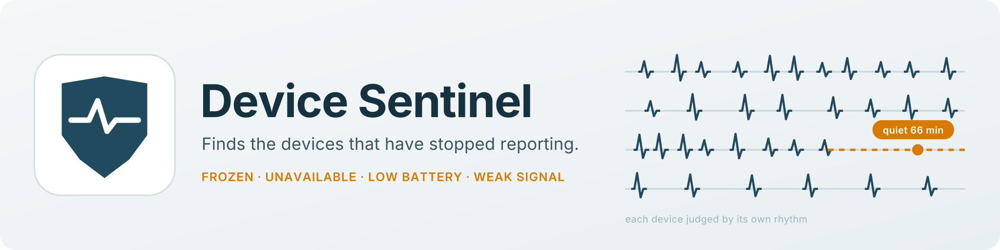
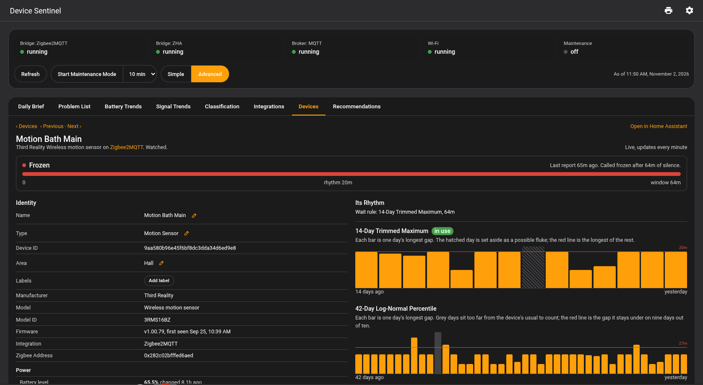

# Device Sentinel

**Device Sentinel tells you when a device in your house stops working, even while Home Assistant still shows its last value.**

## What It Does

Home Assistant can't tell a quiet device from a dead one: a door sensor with a dead battery keeps reading "closed". Device Sentinel learns how often each device reports and tells you when one goes quiet for longer than its own usual. It also watches batteries and radio links, each against that device's own history.

| Problem | What Device Sentinel reports |
|---|---|
| **Frozen** | A device that stopped reporting while still showing a value. |
| **Unavailable** | A device Home Assistant has marked unavailable. |
| **Flapping** | A device that drops out and comes back again and again, as one problem. |
| **Never reported** | A device that has never sent a reading. |
| **Low or falling battery** | A battery under your threshold, or draining fast enough to reach it within your warning time. |
| **Weak or stuck signal** | A radio link weaker than its own normal, or a reading stuck at one value. |

When a Zigbee coordinator, the MQTT broker or your Wi-Fi network goes down, Device Sentinel reports that one failure, not each device behind it.

The story behind Device Sentinel, with more pictures, is in the [overview](docs/OVERVIEW.md).

## Installation

Device Sentinel is in the HACS default store.

1. Open **HACS**, search for **Device Sentinel**, and open it.
2. Click **Download**, then **Restart Home Assistant**.
3. Go to **Settings > Devices and Services > Add Integration** and search for Device Sentinel.

*(Requires Home Assistant 2026.5 or newer)*

## Your First Two Weeks

Device Sentinel works with its defaults from the start. It learns your house over the first two weeks.

1. **Day one.** Open the integration settings and set up **Notifications and Daily Brief**. Leave High-Priority targets empty for now, set Quiet Hours, and send the Daily Brief when they end. Then open the **Recommendations** tab on the Device Sentinel dashboard and turn on any Last Seen, Battery or Z-Wave status sensor it lists as switched off. With Last Seen on, a frozen device is caught in minutes rather than hours.
2. **Week one: clear out the noise.** While Device Sentinel learns, you may hear about things that aren't hardware, such as ping trackers, phone apps or a wall tablet. On the **Exclusions and Muting** screen, exclude what isn't hardware that can fail, and mute what you don't mind going quiet. Leave the Freeze Detection sliders alone.
3. **Week two: frozen devices are reported.** From day 7, a device that stays quiet longer than its own usual is reported frozen. Expect a few false alarms. Mute devices that come and go by nature, such as a car sensor that leaves the driveway. By day 14, you can trust a frozen report.
4. **After that.** Signal baselines settle after three weeks, and a battery is judged falling after four weeks of readings.

[Installation and Setup](https://github.com/TheThinkingHome/device_sentinel/wiki/Installation-and-Setup) in the wiki has each step in full.

## Documentation

The [wiki](https://github.com/TheThinkingHome/device_sentinel/wiki) explains each screen and setting.

- [Installation and Setup](https://github.com/TheThinkingHome/device_sentinel/wiki/Installation-and-Setup)
- [The Dashboard](https://github.com/TheThinkingHome/device_sentinel/wiki/The-Dashboard)
- [The Daily Brief](https://github.com/TheThinkingHome/device_sentinel/wiki/The-Daily-Brief)
- [FAQ and Troubleshooting](https://github.com/TheThinkingHome/device_sentinel/wiki/FAQ-and-Troubleshooting)
- [Screenshots](https://github.com/TheThinkingHome/device_sentinel/wiki/Screenshots)

## Getting Help

- **Something isn't working:** open a [bug report](https://github.com/TheThinkingHome/device_sentinel/issues/new/choose) and attach your diagnostics download (**Settings > Devices and Services > Device Sentinel**, the three dots, **Download diagnostics**). If you'd rather not post it publicly, open the issue without it and you'll be given an email address to send it to.
- **A question:** ask in the [Device Sentinel thread](https://community.home-assistant.io/t/1029252) on the Home Assistant forum, or open an issue.
- **An idea:** open a [feature request](https://github.com/TheThinkingHome/device_sentinel/issues/new/choose). Say what happened in your home that it would have caught.
- **A security problem:** report it privately, as [SECURITY.md](SECURITY.md) describes. Don't open a public issue.

## Contributing

You don't need to write code to help. Device Sentinel learns from real houses.

- **Your hardware:** if your hub, integration or router isn't fully supported, turn on Extended Diagnostics and send the files. [CONTRIBUTING.md](CONTRIBUTING.md) walks through it.
- **Your opinion:** run Device Sentinel for a week or two, then open an issue titled "Review" and tell me what worked and what didn't.
- **Code:** read [CONTRIBUTING.md](CONTRIBUTING.md) first. Device Sentinel's rules are in the [`developer`](developer/Main__Rulebook.md) folder, and the code refers to them by name.

The hardware that has already run on real houses is listed in [TESTED_HARDWARE.md](TESTED_HARDWARE.md).

## Integration Status

| Area | Status | Notes |
|---|---|---|
| **Dashboard** | Working | Simple shows what is broken and what to do about it; Advanced adds the trends, charts and setup. Administrators only. |
| **Freeze Detection** | Stable | Frozen, unavailable and flapping devices, each judged on its own rhythm. |
| **Battery** | Stable | Low batteries, and batteries falling or speeding up, with the time left as a range. |
| **Signal** | Experimental | Weak links shown on the dashboard; stuck readings alert. |
| **Storage** | Hardened | Survives power cuts and restores itself from a backup. |
| **Zigbee2MQTT** | Working | A bridge outage is one alert, and your re-pairs are never mistaken for faults. |
| **MQTT** | Working | A broker outage is one alert, not one per device. |
| **ZHA** | Working | A coordinator outage is one alert, and your re-pairs are recognized. |
| **WiFi** | Working | A Wi-Fi outage is one alert. Needs a wireless adapter on your server or a supported router. |
| **Z-Wave** | Working | A node Z-Wave JS reports dead makes its device unavailable. |
| **Matter** | Working | A light, plug or button that reports only when used is not reported frozen because it is quiet. |
| **Lutron Caséta** | Experimental | Devices are judged by their hub: a hub that goes down is one alert. |

Each release is listed in the [changelog](CHANGELOG.md) and on the [releases page](https://github.com/TheThinkingHome/device_sentinel/releases).

## AI Disclosure

Device Sentinel was built with AI assistance under my direction. Every design decision is mine, and nothing reaches this repository without my review and a full test gate, with detection proven on real hardware. [AI_DISCLOSURE.md](AI_DISCLOSURE.md) explains exactly what the AI did and how every release is checked.

---

**License:** GPL-3.0-or-later. Copyright (C) 2026 James Lander, The Thinking Home.

Battery types come from the device library of [Battery Notes](https://github.com/andrew-codechimp/HA-Battery-Notes) by Andrew Jackson, shipped with Device Sentinel under its MIT licence. The notice is in `custom_components/device_sentinel/data/BATTERY_LIBRARY_LICENSE.md`.
