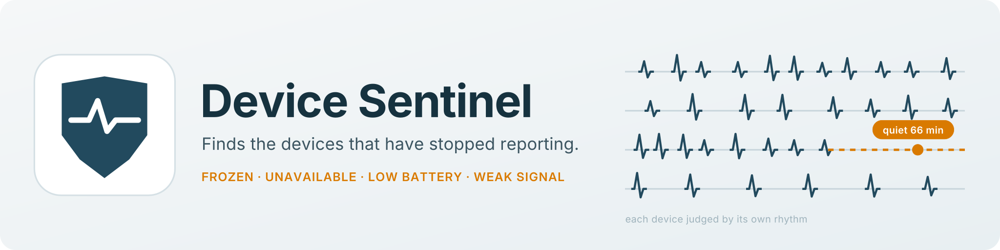
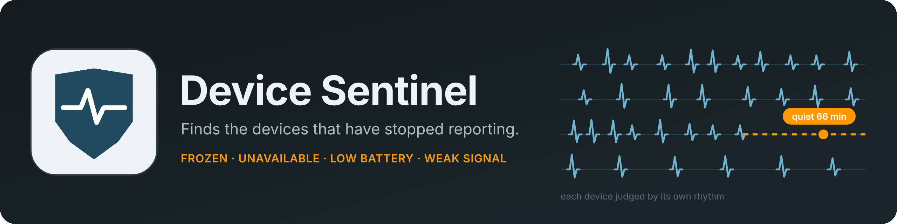

# Device Sentinel Images

The screenshots used in the [README](../../README.md) and the [wiki](https://github.com/TheThinkingHome/device_sentinel/wiki/Screenshots), with what each one shows. They are from a real house running Device Sentinel.

To use one from the wiki, link to its raw address: `https://raw.githubusercontent.com/TheThinkingHome/device_sentinel/main/docs/images/<file name>`, with each space written as `%20`.

## Setting Up

### Device Page Full.png

Device Sentinel's own page in Home Assistant, under Settings > Devices and Services. The controls are the Maintenance Mode and Regenerate Reports buttons. The sensors beneath them count what is wrong, and the diagnostic sensors count what is watched, learned and set aside.

### Integration Settings Main.png

The configuration menu. Each entry opens one screen: Notifications and Daily Brief, Exclusions and Muting, Low Battery, Signal Strength, Freeze and Unavailable Detection, WiFi, Advanced and Extended Diagnostics.

### Integration Settings Exclusions and Muting.png

The Exclusions and Muting screen. Excluded integrations are set aside entirely. Muted integrations, labels and devices are still watched, but never reported.

## The Dashboard

### Device Detail - Daily Brief.png

The Daily Brief tab: one calendar day at a time, with the Problem List worst first, its All, Open and Acknowledged chips, Repeat Offenders and What Happened. The status row across the top shows each bridge, the broker, the Wi-Fi network and Maintenance Mode.

### Device Detail - Network Tab.png

The Networks tab on Advanced: What the Server Hears, the Wi-Fi networks around the server drawn against the Zigbee channels, with the network names blurred; then each network your devices report through, its status, its devices, those with a problem and its last outage.

### Dashboard Battery Trends.png

The Battery Trends tab: every battery by maker and model, then the low cells, the falling cells with their weekly averages and time left, and the steady ones. Click a type to see only that type.

### Dashboard Signal Trends.png

The Signal Trends tab: devices that keep dropping out, days when several devices had a bad day together, one bar per device against its own normal, and the unsteady and steady lists.

### Dashboard Integrations.png

The Integrations tab: one row per integration with its standing, how many of its devices are watched, muted or set aside, its open problems and its outages over fourteen days. The key under the table says what each standing means.

### Dashboard Integration Detail.png

An integration's own page: its devices with problems first, its outages over the last fourteen days, its bursts of updates, and any recommendation that names it.

### Dashboard Devices.png

The Devices tab: every device Device Sentinel found, opening on the watched ones, with each one's type, integration, standing, problem, last report and freeze window. Click a type to narrow the list, or choose the devices with a problem, the muted, the excluded or the ones set aside, each with its reason.

### Device Detail - Recommendations Open.png

The Recommendations tab with one card: the Wi-Fi channel overlapping a neighbour's network, and the clearer channel to move to. Each card has its Acknowledged box.

## A Device's Page

### Device Detail - Door Laundry Frozen.png

A device's page: a door sensor called frozen, its status bar showing the last report against its rhythm and its window, then its identity on the left and its two freeze rules on the right.

### Dashboard Device Detail Identity.png

The Identity section: name, type, device ID, area, labels, maker, model, integration, how it connects, and its address, followed by the Power, Signal and Last seen groups, the wait rule and the mute buttons. A pencil marks what you can change.

### Dashboard Device Detail Type Picker.png

The Type picker. Choose the device's type from the list, or put it in your own words; the answer covers every device of the same model.

### Dashboard Device Detail Area Picker.png

The label picker open on a device page. Add an existing label, or type a new one and press Create and add. A mute by label takes effect without opening the settings.

### Dashboard Device Detail Power Pencil Open.png

The power pencil open. Pick a common battery and how many, or Mains Powered, USB Powered, USB Direct to Server or PoE Powered, or use the Battery Notes library's answer.

### Dashboard Device Detail Clone Hardware.png

The Same hardware row on a Bluetooth proxy's page. Two other integrations list the same hardware; each is named with its integration and why it is not watched.

### Dashboard Device Detail Rhythm Chart.png

The rhythm graph: each day's longest gap, both rules' waits as dashed lines, the day that set the trimmed wait, days set aside, and a red dot where a gap ran past its window. Outages on the device's path are shaded behind it.

### Battery Chart - Below Threshold.png

The battery history on a device's page: the level over 132 days with its smoothed line and usual bounce, the weekly readings above it, the low threshold as a dashed line, and the time left.

### Dashboard Device Detail Signal Chart.png

The signal graph: each day's median and low end against the device's own normal and its bad-day line. A bad day is marked with a red dot.

## A Real Frozen Sensor

The Door Laundry door sensor that stopped reporting on 20 November 2026, with notes added in magenta.

### Zigbee2MQTT - Door Laundry Still Online.png

Zigbee2MQTT's page for the sensor three hours after its last report: battery 100%, last seen 3 hours ago, and still online, since Zigbee2MQTT waits 25 hours before it calls a battery device offline.

### Device Detail - Door Laundry Reporting.png

The sensor's Power, Signal and Reporting rows: a coin cell reading 100% at 3.005 V, its last report at link quality 168, and its last seen time.

### Device Detail - Door Laundry Gaps.png

The Gaps, Last 14 Days table: the gap that began at 1:30 PM, and two earlier quiet spells of 1.7 hours that came back inside the window.

### Device Detail - Door Laundry Signal.png

The sensor's signal chart: its link quality dropped at the start of November, three weeks before it stopped reporting.

### Device Detail - Door Laundry Rhythm.png

The sensor's rhythm chart: on most days since July, its longest gap between reports was under an hour.

## Sensors

### sensor.device_sentinel_bridge & _broker.png

The Bridge: Zigbee2MQTT and Broker: MQTT sensors with their attributes: the bridge's permit-join state and availability setting, and the broker's start time, uptime, cadence and threshold.

## Repairs

### Repair Card Damaged Data File.png

A Repair card after Device Sentinel repaired a damaged data file. It says what was repaired and where the original is. Nothing is asked of you; Submit records that you read it.

## Your Automations

### Event Automation Example.png

An automation built on Device Sentinel's events. When a presence sensor is reported frozen or unavailable, it power-cycles the sensor's plug and waits for device_sentinel_recovered; if the sensor doesn't come back in fifteen minutes, it raises a notification. A second trigger turns the plug back on if it has been off for a minute.

## Banners

### device-sentinel-banner.svg

The Device Sentinel banner the README shows. It turns dark or light with the reader's browser or system setting, on GitHub and on the HACS page.

### device-sentinel-banner-light.png

The Device Sentinel banner, light version.

### device-sentinel-banner-dark.png

The Device Sentinel banner, dark version.

